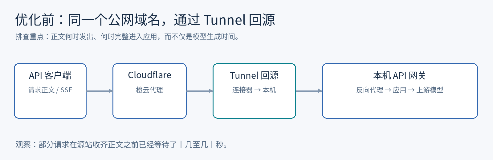
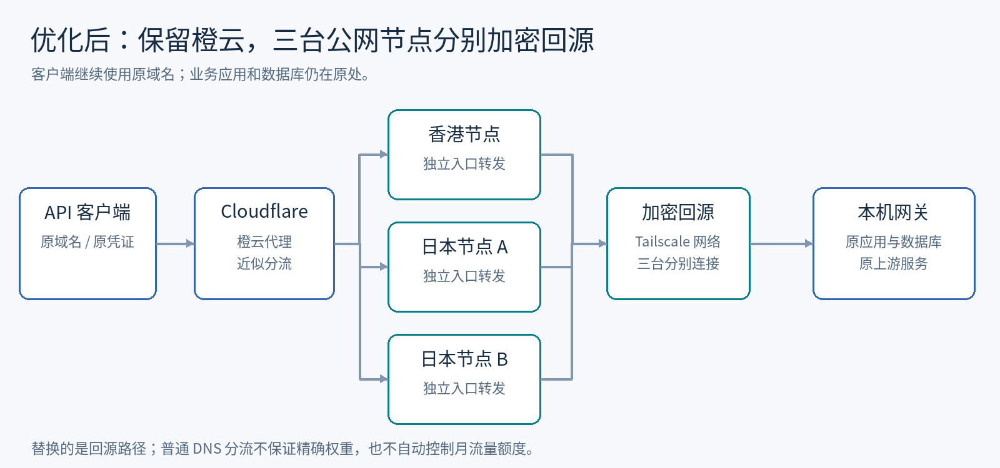

# API 首字等待几十秒，后台却只统计 6 秒：一次公网入口延迟排查

> 一次 LLM API 网关排查：从“模型怎么这么慢”，逐步定位到公网入口交付请求正文的延迟，最后保留 Cloudflare 橙云代理，用三台公网节点加密回源，替换原来的 Tunnel 路径。
>
> 作者：[ychy7001](https://github.com/ychy7001) · 记录日期：2026-10-19

## 用户等到的时间，为什么和后台记录不一样？

问题最初出现在编程助手里：同一个 API，服务器本地调用很快，笔记本通过公网访问却经常要等几十秒才能看到响应。另一些请求还出现了接近两分钟的 Cloudflare 524 超时。

后台用量页面又给出了一个容易误导判断的数字：首字耗时只有几秒。客户端仍在等待，统计看起来却很正常。

这几个现象来自不同请求，不能把它们拼成同一次测量。它们共同提示的是：**先确认统计指标从哪里开始计时，再判断慢在哪一段。**

这次排查针对的是运行中的 Sub2API 网关。为便于公开复盘，以下使用节点代号，不展示业务域名、IP、账号和原始会话内容。

## 先把一次请求拆开

原来的访问链路如下：

用户感受到的总等待，可能包含：

1. 客户端准备请求、DNS 查询及连接建立。
2. 请求正文上传，以及公网入口向本机交付正文。
3. 网关读取正文、鉴权、调度和可能的排队。
4. 上游请求、失败重试，以及模型开始生成前的等待。
5. 流式数据沿途返回，最终显示在客户端。

这些阶段可能相互重叠；这是一种排查划分，不是可以直接相加的精确计时公式。客户端有完整计时，网关访问日志有计时，用量记录也有计时，但三者覆盖的区间可能不同。

后面的实验发现，这里同时存在两类问题：正文进入网关很慢，以及个别上游失败后重试。用量页面没有完整体现这些等待，不能用它替代端到端计时。

## 第一个对照：同一上游，本机快在哪里？

直接把公网调用和本地调用各跑一次，还不足以排除上游调度差异。我们选取了同一 API Key、同一模型、同一上游账号、相近时间的实际请求，再按日志中的阶段时间对照。

| 样本 | 正文字节数 | 网关访问日志耗时 | 进入应用至正文读取完成及此前中间件耗时 | 最后成功上游尝试耗时 |
| --- | ---: | ---: | ---: | ---: |
| 本机 A | 70,461 | 3.535 秒 | 约 0.001 秒 | 3.526 秒 |
| 公网 A | 74,746 | 32.110 秒 | 约 29.953 秒 | 2.149 秒 |
| 本机 B | 70,458 | 2.843 秒 | 约 0.001 秒 | 2.831 秒 |
| 公网 B | 74,745 | 28.047 秒 | 约 25.488 秒 | 2.530 秒 |

表中“正文读取完成及此前中间件耗时”由访问日志和读取完成后的审计时间点推算，并非每个阶段都安装了独立计时器。它也不包含请求进入应用之前的全部公网时间。

尽管如此，差异已经足够明确：**公网样本新增的大部分等待，发生在成功上游尝试之前。** 两组公网请求的成功上游尝试都只用了约 2 秒，不能解释网关记录中的 28–32 秒。

还有一个容易忽略的事实：在编程助手里输入 `ping`，HTTP 请求正文也可能有约 75 KB。可见输入很短，请求仍可能携带上下文、工具定义等内容。排查时应该测量实际字节数，不能凭输入框里的字数估计流量。

## 第二个对照：暂时移走模型这个变量

如果每次实验都调用真实模型，账号选择、模型负载和重试会干扰网络测量。

我们利用当前部署的请求处理顺序构造了一类请求：使用有效认证，发送合法 JSON，填入随机正文，但省略必需的 `model` 字段。该服务会先完整读取正文，再返回预期的 HTTP 400，因此不会进入模型生成阶段。

这个方法的前提很重要：**必须先确认当前版本确实完整读取正文后才报错。** 如果某个网关在读正文前就拒绝请求，这种测试便不能说明正文传输是否正常。

测试同时记录正文大小、客户端协议、连接及总耗时、返回状态。初步对照得到：

- 本机应用与本机反向代理路径，约 444 KB 正文可在毫秒量级完成读取并返回。
- 公网路径却可能等待几十秒，甚至触发超时。
- 客户端的 curl 记录表明，部分约 75 KB 请求在约 1 秒内已完成客户端侧上传操作，但源站仍需十几至几十秒才收齐。

“客户端上传完成”只说明客户端侧已完成相应发送操作，不能单独证明源站已经收到正文。为了判断中间发生了什么，我们只抓取了源站 loopback 上的时间、字节进度和必要请求头元数据，没有保存正文或鉴权头。

其中一次真实请求共 74,743 字节，源站从收到请求头到收齐正文约用了 **19.460 秒**。正文读完后，约 2.968 秒便返回了成功响应。

到这里，把主要原因归到模型推理已经不符合证据。

## 不同出口表现不同，是否就是 Wi-Fi 的问题？

继续测试发现，同样大小的请求，从不同出口发出，速度差异很明显。

这很容易引出“无线网络慢”的解释。但请求走公网域名，即使发起端就在源站上，也仍然要经过外部入口；不同出口还可能影响后续路径和连接选择。

我们交叉测试了 HTTP/1.1、HTTP/2、重复内容与随机内容，差异仍然存在。随后在串行测试前后读取 cloudflared 的连接接收字节计数，比较正文的主要字节增量落在哪一条连接上。

| 来源出口 | 轮次 | 正文字节数 | 总耗时 | 主要接收增量对应连接 |
| --- | --- | ---: | ---: | --- |
| 出口 A | 1 | 74,758 | 2.341 秒 | 连接 A，SJC 位置标记 |
| 出口 B | 1 | 74,758 | 14.489 秒 | 连接 B，LAX 位置标记 |
| 出口 A | 2 | 74,758 | 2.353 秒 | 连接 A，SJC 位置标记 |
| 出口 B | 2 | 74,758 | 13.365 秒 | 连接 B，LAX 位置标记 |

接收计数可能混入少量同期流量，但各轮主要正文增量集中在对应连接。当前实验支持“这些请求走到了快慢不同的 Tunnel 连接路径”。

它不能进一步证明无线链路本身有问题，也不能证明所有 LAX 节点都慢。运营商路径、Cloudflare 内部转发和具体连接状态仍未完全分开。

我们也测试过连接器协议、出口绑定、客户端版本和新建连接等调整，没有得到足够可重复的改善，便撤回了这些实验配置。曾有一次入口绕行对某个来源效果很好，后来换来源又复现慢速，这也说明：**单个来源成功，不足以宣布公网入口恢复。**

## 保留橙云，替换 Tunnel 回源

要求每个客户端改成 SSH 转发，能够帮助诊断，却不适合作为对外服务的常规接入方式。

最后验证的方案是：保留客户端域名和 Cloudflare 橙云代理，让 Cloudflare 回源到公网节点，再通过 Tailscale 加密网络回到本机网关。

这里有两个独立概念：

- **橙云代理**：客户端仍然连接 Cloudflare，Cloudflare 再连接配置的回源地址。
- **Tunnel**：源站通过连接器建立的回源通道。

此次没有切成灰云。变化发生在回源段：从 Tunnel 路径，改为公网节点加密回源。

最初香港节点的对照效果明显，但单台服务器有月流量包限制。最终纳入一台香港节点和两台日本节点，各自独立连接本机，避免所有回源流量都经过某一台中转。

三条同域名 A 记录均开启代理。这提供近似分流，并不等于精确三等分，也不具备按供应商剩余流量额度分配的能力。Cloudflare 官方对这种多回源方式和额外 Load Balancing 产品的区别有[说明](https://developers.cloudflare.com/dns/manage-dns-records/how-to/round-robin-dns/)。

部署时还处理了几项直接影响结果的细节：正式 HTTPS 证书及续期同步、流式转发及时发送、真实客户端地址的可信代理边界，以及节点健康和流量采样。公网节点只承担入口转发，业务应用和数据库仍在原处。

## 五台外部客户端复测，改善有多大？

为了避免再次只验证到某个快来源，我们使用五台可通过 SSH 操作的服务器模拟外部客户端。

前后测试保持相同方法：每个客户端内部顺序发送，五个客户端并行；有效认证、相同大小的随机 JSON、缺少 `model`，预期返回 400。每个客户端都覆盖健康检查、约 1 KB、约 75 KB 的 HTTP/1.1 与 HTTP/2，以及约 444 KB 的 HTTP/2 请求。

下面摘录 HTTP/2 结果。节点为脱敏代号；每一格是本轮对应条件的一次测量，不是 P95、持续压测或最大承载能力。

| 客户端 | 约 75 KB：原入口 | 约 75 KB：新入口 | 约 444 KB：原入口 | 约 444 KB：新入口 |
| --- | ---: | ---: | ---: | ---: |
| 香港客户端 | 49.081 秒 | 1.306 秒 | 50 秒超时 | 1.372 秒 |
| 日本客户端 A | 11.498 秒 | 0.417 秒 | 50 秒超时 | 1.730 秒 |
| 日本客户端 B | 1.277 秒 | 0.206 秒 | 3.919 秒 | 0.903 秒 |
| 客户端 C | 41.824 秒 | 2.124 秒 | 50 秒超时 | 3.950 秒 |
| 客户端 D | 39.746 秒 | 2.007 秒 | 50 秒超时 | 10.868 秒 |

正文大小分别为 74,758 和 443,671 字节，全文 KB 均按约数表述。表中超时表示客户端在 50 秒时结束测试，不能将其当成实际耗时恰好为 50 秒。

新入口这轮共 25 次检查全部返回预期结果：5 次健康检查为 200，20 次正文测试为 400。另有 75 次直接指定中转节点、校验正常 HTTPS 证书的检查全部通过。直接指定 IP 仅用于实验，不是客户端日常使用要求。

三台中转均观察到实际请求，本轮 25 次分别分配了 15、5、5 次，进一步说明样本内并没有严格均分。

数据保留在同目录的 [results.csv](results.csv)。这组结果支持新路径在当前样本下明显减少入口延迟，也保留了约 444 KB 请求仍可能耗时十秒左右的结果。不能只挑香港单节点的小于一秒结果，代表所有来源。

## 最后还要走一遍真实模型请求

入口测试通过后，我们再用正式域名验证真实 SSE 响应：

| 请求类型 | 首个 SSE data | 总耗时 | 完成标记 |
| --- | ---: | ---: | --- |
| Codex 请求 | 6.730 秒 | 7.144 秒 | `response.completed` |
| Claude 请求 | 5.962 秒 | 6.514 秒 | `message_stop` |

“首个 SSE data”是客户端测试脚本首次读到 `data:` 行的时间，它可能是元数据事件，不能直接等同于第一个可见文字。

这里还有一项没有因入口优化而消失的问题：某个上游账号偶发等待约 30 秒后失败，网关再切换到其他账号。一次直接经过香港中转的 Codex 测试仍因此用了约 35.9 秒，日志中能看到失败和切换。

因此，看到“后台只记几秒、用户等得更久”，至少应该分别检查正文接收时间，以及前面失败尝试和重试时间是否被计入。它们可以同时出现，不能用同一个修复解释全部延迟。

## 这次留下的排查方法

如果以后再次遇到“本机快，公网慢”，我会先做这几件事：

1. 对齐计时区间，区分端到端等待、访问日志和用量指标。
2. 测量实际请求体大小，不用可见输入长度代替它。
3. 构造可验证的无模型请求，先隔离入口传输。
4. 同时看客户端发送进度和源站接收进度。
5. 换来源、协议和正文特征验证，避免以单次成功代表所有客户端。
6. 修改链路后，用相同条件复测，并完成真实流式请求。

这次已经证明的，是替换回源路径后，测试中的入口延迟明显下降。原 Tunnel 慢速路径的底层原因、长期稳定性，以及上游重试统计的完善，仍需要后续证据。

我希望保留下来的不是“遇到慢就加三台 VPS”这个配方，而是把用户等待拆成可测量的阶段，再让每个实验回答一个具体问题的过程。
